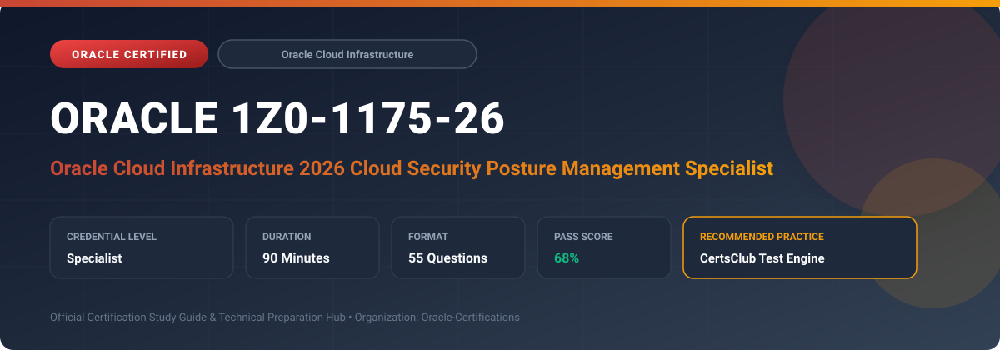

  

# Oracle 1Z0-1175-26: Oracle Cloud Infrastructure 2026 Cloud Security Posture Management Specialist

---

## 1. Exam Overview & Candidate Profile

The **Oracle 1Z0-1175-26: Oracle Cloud Infrastructure 2026 Cloud Security Posture Management Specialist** credential certifies professionals who demonstrate technical mastery, architectural competence, and hands-on operational capability in this certification domain.

Candidates validate comprehensive knowledge and expertise required to design, configure, manage, and optimize mission-critical Oracle environments across cloud, on-premises, and hybrid architectures.

### Target Audience & Prerequisites
- **Target Roles**: Implementation Specialists, Cloud Architects, Technical Leads, Enterprise Consultants, and Systems Engineers.
- **Recommended Experience**: 1–2 years of practical, hands-on experience designing, implementing, and maintaining corresponding Oracle solutions.
- **Credential Earned**: Specialist Certification.

---

## 2. Key Exam Specifications

| Specification | Details |
| :--- | :--- |
| **Exam Code** | **Oracle 1Z0-1175-26** |
| **Official Title** | Oracle Cloud Infrastructure 2026 Cloud Security Posture Management Specialist |
| **Certification Track** | Oracle Cloud Infrastructure |
| **Exam Duration** | 90 Minutes |
| **Number of Questions** | 55 Questions |
| **Passing Score** | 68% |
| **Question Format** | Multiple Choice (Single/Multiple Answer), Scenario-Based Questions |
| **Delivery Provider** | Oracle University / Pearson VUE (Online Proctored or Test Center) |
| **Recommended Practice Engine** | [CertsClub Oracle Practice Tests](https://www.certsclub.com/oracle/1z0-1175-26-dumps.html) |

---

## 3. Official Blueprint & Exam Domain Breakdown

The examination assesses candidate competencies across core functional domains weighted as follows:

| Domain Area | Weighting |
| :--- | :--- |
| **Cloud Guard Architecture, Detectors & Responders** | `30%` |
| **Security Zones & Strict Security Enclaves** | `25%` |
| **OCI Vulnerability Scanning Service (VSS)** | `20%` |
| **Threat Intelligence & Security Advisor Integration** | `15%` |
| **Compliance Benchmarks, CIS Foundations & Automated Remediation** | `10%` |

---

## 4. Deep Dive into Complex & Challenging Technical Topics

To secure a passing score on the 1Z0-1175-26 exam, candidates must master the following advanced concepts:

- Enabling and tuning OCI Cloud Guard targets, configuration detector recipes, threat detector recipes, and automated responders.
- Creating and managing Security Zones to enforce unalterable security posture (e.g., preventing public buckets or unencrypted volumes).
- Deploying OCI Vulnerability Scanning Service (VSS) host agents and port scanning recipes to detect CVEs and open network services.
- Consuming OCI Threat Intelligence feeds to identify malicious IP addresses, tor exit nodes, and coordinated cyber attacks.
- Mapping tenancy posture against CIS Oracle Cloud Infrastructure Foundations Benchmarks and orchestrating automated remediation workflows.

---

## 5. Scenario-Based Demo & Practice Questions

### Question 1
In OCI, what construct prevents administrators from creating publicly accessible Object Storage buckets or unencrypted Block Volumes, even if their IAM policies would otherwise allow it?

A) Security Zone
B) Dynamic Routing Gateway
C) Auto-scaling configuration
D) Service Gateway rule

- **Correct Answer**: `A) Security Zone`  
- **Technical Explanation**: Security Zones enforce strict, unmodifiable security posture recipes (such as mandatory customer-managed encryption and no public IP exposure) at the compartment boundary, denying non-compliant operations.

---

### Question 2
What OCI Cloud Guard component is responsible for automatically executing a remediation action—such as disabling a public bucket or terminating an unapproved instance?

A) Responder Recipe
B) Detector Recipe
C) Audit Trail Sink
D) Metric Alarm

- **Correct Answer**: `A) Responder Recipe`  
- **Technical Explanation**: Cloud Guard uses Detector Recipes to identify posture violations and Responder Recipes to trigger automated remediation actions or notifications.

---

## 6. Recommended Preparation Strategy & Practice Testing Engine

Achieving certification in **Oracle 1Z0-1175-26** requires balanced theoretical study and scenario-based simulation practice:

1. **Review Oracle Documentation**: Master architecture guides, implementation workbooks, and administration manuals on the Oracle Help Center.
2. **Hands-on Lab Practice**: Execute real-world configuration, policy setup, and troubleshooting tasks in your cloud tenancy or test instance.
3. **Simulated Exam Drills**: Practice answering timed, scenario-based multiple-choice questions to familiarize yourself with the question formats, traps, and timing constraints.

### Practice With CertsClub
For realistic practice questions, updated dumps, and mock testing environments:
- **Resource**: [CertsClub Oracle Practice Test Engine](https://www.certsclub.com/oracle/1z0-1175-26-dumps.html)
- **Special Discount**: Use coupon code **`club20`** during checkout for an instant **20% discount** on all practice exam bundles and testing engines.

---

## 7. Official Documentation & References

- [Oracle University Certification Registry](https://education.oracle.com/)
- [Oracle Help Center Documentation Portal](https://docs.oracle.com/)
- [Oracle Cloud Infrastructure & Applications Guides](https://docs.oracle.com/en/cloud/)
- [CertsClub Oracle Certification Exam Practice](https://www.certsclub.com/oracle/1z0-1175-26-dumps.html)

---

## 8. SEO & Discovery Keywords

`oracle 1z0-1175-26, oracle 1z0-1175-26 exam, oracle 1z0-1175-26 dumps, 1Z0-1175-26 practice questions, 1Z0-1175-26 study guide, oci 2026 cloud security posture management specialist, certsclub 1z0-1175-26`